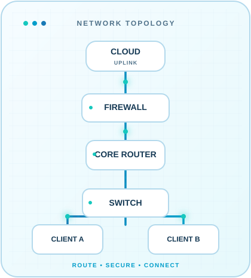

<!--
  JODEANE / JODEANE — personal GitHub profile
  Verified public GitHub handle: https://github.com/Jodeane
  Place this file in the PUBLIC repository: https://github.com/Jodeane/Jodeane
  Keep assets/ and .github/workflows/snake.yml in the same repository.
  To activate social links, follow SETUP.md. Never publish a private email by accident.
  Animated third-party cards need network access; GitHub and providers can cache or rate-limit them.
-->

<!-- ===================== ADAPTIVE HEADER ===================== -->

  <picture>
    <source media="(prefers-color-scheme: dark)" srcset="https://capsule-render.vercel.app/api?type=waving&amp;color=0:06131F,40:103955,75:126994,100:00C9C8&amp;height=195&amp;section=header&amp;text=CONNECT%20%E2%80%A2%20SECURE%20%E2%80%A2%20BUILD&amp;fontSize=26&amp;fontAlignY=40&amp;fontColor=E8FBFF&amp;animation=fadeIn" />
    <source media="(prefers-color-scheme: light)" srcset="https://capsule-render.vercel.app/api?type=waving&amp;color=0:E9FAFF,35:BFE9F3,70:66C4DB,100:0584BB&amp;height=195&amp;section=header&amp;text=CONNECT%20%E2%80%A2%20SECURE%20%E2%80%A2%20BUILD&amp;fontSize=26&amp;fontAlignY=40&amp;fontColor=07334F&amp;animation=fadeIn" />
    
  </picture>

  <h1>Hey there, I'm Jodeane Kyle Bee 👋</h1>

  <a href="https://github.com/Jodeane">
    <picture>
      <source media="(prefers-color-scheme: dark)" srcset="https://readme-typing-svg.demolab.com?font=JetBrains+Mono&amp;weight=600&amp;size=21&amp;duration=3000&amp;pause=1000&amp;color=31D8E8&amp;center=true&amp;vCenter=true&amp;repeat=true&amp;width=820&amp;height=58&amp;lines=Aspiring+Network+Engineer+%F0%9F%8C%90;Routing+%7C+Switching+%7C+Network+Security;Exploring+Cloud+%26+Automation;One+packet+at+a+time" />
      <source media="(prefers-color-scheme: light)" srcset="https://readme-typing-svg.demolab.com?font=JetBrains+Mono&amp;weight=600&amp;size=21&amp;duration=3000&amp;pause=1000&amp;color=087AAB&amp;center=true&amp;vCenter=true&amp;repeat=true&amp;width=820&amp;height=58&amp;lines=Aspiring+Network+Engineer+%F0%9F%8C%90;Routing+%7C+Switching+%7C+Network+Security;Exploring+Cloud+%26+Automation;One+packet+at+a+time" />
      
    </picture>
  </a>

  
<code>jodeane@network:~$ learn --connect --secure --build</code>

  
  &nbsp;
  
  &nbsp;
  

<!-- ====================== ABOUT ME: 65 / 35 ====================== -->
<h2 align="center">🌐 About Me</h2>

<em>Curious about the infrastructure that keeps people, systems and ideas connected.</em>

<table width="100%">
  <tr>
    <td width="65%" valign="middle">
      <h3>Hi, I'm Jodeane!</h3>
      
I'm an aspiring <strong>Network Engineer</strong>, building a foundation in how networks connect, operate, and stay secure. I enjoy learning by experimenting, solving problems, and turning concepts into working projects.

      
🔹 <strong>Learning:</strong> TCP/IP, subnetting, routing, switching and troubleshooting. 
      🔹 <strong>Exploring:</strong> cybersecurity, cloud infrastructure, Linux and automation. 
      🔹 <strong>Building with:</strong> Python and web technologies. 
      🔹 <strong>Mindset:</strong> Understand the fundamentals. Test, document, improve.

      
<a href="https://github.com/Jodeane/FixItJozi"><strong>Featured project: FixItJozi ↗</strong></a> A Django-based community issue-reporting platform for reporting and tracking local problems.

      
<code>Current status: learning in public</code>

    </td>
    <td width="35%" align="center" valign="middle">
      <picture>
        <source media="(prefers-color-scheme: dark)" srcset="./assets/network-topology-dark.svg" />
        <source media="(prefers-color-scheme: light)" srcset="./assets/network-topology-light.svg" />
        
      </picture>
    </td>
  </tr>
</table>

<!-- ====================== TECH STACK ====================== -->
<h2 align="center">🛠️ Tools &amp; Technologies</h2>

Projects I've explored and tools I'm learning along the way.

  <picture>
    <source media="(prefers-color-scheme: dark)" srcset="https://skillicons.dev/icons?i=python,django,html,css,js,linux,ubuntu,windows,bash,powershell,docker,git,github,vscode&amp;perline=7&amp;theme=dark" />
    <source media="(prefers-color-scheme: light)" srcset="https://skillicons.dev/icons?i=python,django,html,css,js,linux,ubuntu,windows,bash,powershell,docker,git,github,vscode&amp;perline=7&amp;theme=light" />
    
  </picture>
  

    
    
    
  

<!-- ====================== LIVE STATS ====================== -->
<h2 align="center">📊 GitHub Pulse</h2>

<em>Every contribution is another connection made.</em>

  <picture>
    <source media="(prefers-color-scheme: dark)" srcset="https://streak-stats.demolab.com?user=Jodeane&amp;hide_border=true&amp;background=071522&amp;ring=00BFD1&amp;fire=23D8C8&amp;currStreakLabel=33D8E8&amp;sideLabels=C4E5F1&amp;currStreakNum=23D8C8&amp;sideNums=E5F7FF&amp;dates=82ABBC" />
    <source media="(prefers-color-scheme: light)" srcset="https://streak-stats.demolab.com?user=Jodeane&amp;hide_border=true&amp;background=F3FBFE&amp;ring=058BB8&amp;fire=009F9F&amp;currStreakLabel=087AAB&amp;sideLabels=1B4B61&amp;currStreakNum=008C92&amp;sideNums=15455B&amp;dates=5A8496" />
    
  </picture>

  <picture>
    <source media="(prefers-color-scheme: dark)" srcset="https://github-readme-activity-graph.vercel.app/graph?username=Jodeane&amp;bg_color=071522&amp;color=C5E5F2&amp;title_color=37D8E9&amp;line=0AB4DA&amp;point=28DAC4&amp;area=true&amp;area_color=0A6C8D&amp;hide_border=true&amp;radius=12&amp;custom_title=Contribution%20Activity" />
    <source media="(prefers-color-scheme: light)" srcset="https://github-readme-activity-graph.vercel.app/graph?username=Jodeane&amp;bg_color=F3FBFE&amp;color=21536D&amp;title_color=087AAB&amp;line=058DBA&amp;point=00AFA7&amp;area=true&amp;area_color=B7EAF0&amp;hide_border=true&amp;radius=12&amp;custom_title=Contribution%20Activity" />
    
  </picture>

<!-- ====================== CONTRIBUTION SNAKE ====================== -->
<h2 align="center">🐍 Contribution Snake</h2>

<em>Follow the packets across my contribution graph.</em>

<!--
  ACTION REQUIRED: The included .github/workflows/snake.yml generates both snake SVGs
  and publishes them on the 'output' branch. Enable Actions and run it once manually.
  The images below appear only AFTER the action successfully publishes that branch.
-->

  <picture>
    <source media="(prefers-color-scheme: dark)" srcset="https://raw.githubusercontent.com/Jodeane/Jodeane/output/github-contribution-grid-snake-dark.svg" />
    <source media="(prefers-color-scheme: light)" srcset="https://raw.githubusercontent.com/Jodeane/Jodeane/output/github-contribution-grid-snake.svg" />
    
  </picture>

<!-- ====================== CONNECT ====================== -->
<h2 align="center">📡 Let's Connect</h2>

Open to learning, collaboration, and conversations about technology.

  
  <!-- These neutral badges deliberately have NO fake links. See SETUP.md to activate them. -->
  
  
  
  
  
<code>Stay curious. Keep learning. Build what connects us.</code>

<!-- ====================== ADAPTIVE FOOTER ====================== -->
<picture>
  <source media="(prefers-color-scheme: dark)" srcset="https://capsule-render.vercel.app/api?type=waving&amp;color=0:00C9C8,35:087BA8,70:103955,100:06131F&amp;height=125&amp;section=footer" />
  <source media="(prefers-color-scheme: light)" srcset="https://capsule-render.vercel.app/api?type=waving&amp;color=0:0584BB,35:66C4DB,70:BFE9F3,100:E9FAFF&amp;height=125&amp;section=footer" />
  
</picture>
